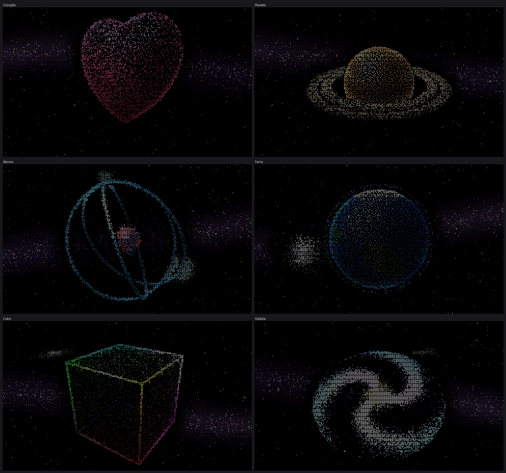

# Partículas 3D

**9.600 pontos que viram objetos 3D no terminal do Windows, comandados por gestos da mão
na webcam.**

Você faz um gesto com a mão (👌, ✌️, 🤟, 🤙...) na frente da câmera e uma nuvem de pontos
coloridos se reorganiza em um planeta com anéis, uma hélice de DNA, um coração que bate,
um átomo com elétrons em órbita... Tudo desenhado com caracteres Braille dentro do
`cmd`/Windows Terminal, sobre um céu com a Via Láctea. Com a mão aberta você "segura" o
objeto e gira em 3D; com as duas mãos dá zoom; com a pinça desenha no ar.



---

## Sumário

- [Destaques](#destaques)
- [Requisitos](#requisitos)
- [Instalação e uso rápido](#instalação-e-uso-rápido)
- [As 18 formas e seus gestos](#as-18-formas-e-seus-gestos)
- [Controles](#controles)
- [Calibração pessoal](#calibração-pessoal)
- [Testes e diagnóstico](#testes-e-diagnóstico)
- [Como funciona (visão geral)](#como-funciona-visão-geral)
- [Estrutura do repositório](#estrutura-do-repositório)
- [Privacidade](#privacidade)
- [Documentação completa](#documentação-completa)

## Destaques

- **18 formas 3D animadas:** coração implícito que bate, planeta com anéis, estrela 3D,
  galáxia em rotação diferencial, DNA, cubo, pirâmide, infinito, rosto feliz, flor, raio,
  rosquinha, átomo, Terra com a Lua, diamante, árvore de Natal, tornado e ondas.
- **Três formas de comandar:** pose da mão na câmera, traço desenhado no ar com a pinça
  ou traço com o mouse.
- **Gráficos 3D dentro do console:** perspectiva, iluminação difusa + especular + luz de
  borda, oclusão, neblina de profundidade e pontilhado por sombreamento, com 2×4 pontos por
  caractere (Braille) e cor verdadeira (24 bits).
- **Céu de fundo:** Via Láctea com nebulosa e faixa de poeira, galáxia tipo Andrômeda e
  ~3.500 estrelas, com paralaxe ao girar. O fundo se apaga em volta da figura para nunca
  atrapalhar a leitura (verificado por teste automático).
- **Reconhecimento de mãos robusto:** MediaPipe + classificador probabilístico próprio
  com fusão temporal, histerese e recusa de casos ambíguos. Com a mão real do autor:
  **97,2% de acerto na validação e 0% de disparo errado**.
- **Calibração pessoal guiada** em ~2 minutos, com validação honesta antes de salvar.
- **Leve:** ~1,6 ms por quadro de renderização, saída diferencial que economiza ~42% da
  banda enviada ao terminal, 40 quadros por segundo.
- **Sem dependências para compilar:** o `.exe` é gerado com o compilador C# que já vem no
  Windows.

## Requisitos

| Item | Para quê |
|---|---|
| Windows 10/11 (64 bits) | o programa usa a API de console do Windows |
| Windows Terminal (recomendado) ou `cmd` | exibir cor de 24 bits e caracteres Braille |
| Webcam | gestos da mão (sem câmera, o mouse continua funcionando) |
| Python 3.9+ | só para o rastreador de mãos (MediaPipe) |
| .NET Framework 4 | já vem no Windows; usado para rodar e para recompilar |

## Instalação e uso rápido

1. Baixe ou clone o repositório:
   ```bash
   git clone https://github.com/AlanSouzaDev7/Projet-Particula.git
   ```
2. Dê dois cliques em **`instalar.bat`** (uma vez só). Ele cria um ambiente Python em
   `%LOCALAPPDATA%\Particulas`, instala o MediaPipe e baixa o modelo de detecção de mãos.
3. Abra **`Particulas.exe`**. A câmera liga sozinha em ~5 segundos; mostre a mão.
4. (Opcional, recomendado) Rode **`calibrar.bat`** para ajustar o reconhecimento à sua mão.

Para deixar a imagem maior e mais nítida, maximize a janela ou diminua a fonte do terminal
(`Ctrl` + `-`). Aperte `H` dentro do programa para ver o guia na tela.

Para recompilar o executável depois de mexer no código:

```bash
build.bat
```

## As 18 formas e seus gestos

Faça a pose e segure por ~meio segundo (a barra do painel "câmera", no canto inferior
direito, enche e os pontos montam o objeto). Ou desenhe o traço no ar com a pinça
(polegar encostado no indicador) ou com o botão esquerdo do mouse.

| Forma | Pose da mão | Traço (no ar ou mouse) |
|---|---|---|
| Coração 3D (bate) | 🤟 Eu te amo, ou coração com as duas mãos | coração |
| Planeta com anéis | 👌 OK | círculo |
| Estrela 3D | ☝️ 1 dedo (indicador) | estrela de 5 pontas |
| Galáxia (gira) | 🤙 Hang loose (polegar + mindinho) | espiral |
| DNA | ✌️ V | letra S |
| Cubo | 4 dedos (polegar dobrado) | quadrado |
| Pirâmide | 3 dedos | triângulo |
| Infinito | ☝️☝️ duas mãos, 1 dedo em cada | ∞ (oito deitado) |
| Rosto feliz 3D | 👍 Joinha | letra U |
| Flor | mindinho sozinho | letra W |
| Raio | 🤘 Rock (indicador + mindinho) | letra Z |
| Rosquinha | ✊✊ dois punhos | círculo duplo |
| Átomo | 🖖 Spock, ou duas mãos em L (moldura) | 8 em pé |
| Terra com a Lua | ✌️✌️ duas mãos em V | arco ∩ |
| Diamante | L (polegar + indicador) | losango ◇ |
| Árvore de Natal | (só por traço) | chapéu ^ |
| Tornado | 👎 Negativo | letra V |
| Ondas | Pistola (polegar + indicador + médio) | onda ~ |

Depois que uma forma aparece, a próxima troca só é liberada após **2,4 segundos** (para
o objeto não ficar trocando sem querer). Se você já estiver segurando a nova pose, ela
entra assim que o tempo acabar.

## Controles

| Gesto | Efeito |
|---|---|
| 🖐 Mão aberta | "segura" o objeto: mover a mão gira em 3D |
| 👋 Mão aberta passando rápido para o lado | próxima / anterior forma |
| 🖐🖐 Duas mãos abertas | afastar = zoom, juntar = afastar |
| ✊ Punho (segure) | desmancha o objeto e espalha os pontos |
| ✊ → 🖐 Fechar e abrir de repente | explosão de partículas |
| 🤏 Pinça parada | onda de choque no ponto |
| Traço reto → / ← | próxima / anterior |
| Traço reto ↓ / ↑ | espalhar / reunir |
| Mouse: botão direito / roda | onda de choque / zoom |
| Teclado: `H` / `Q` ou `Esc` | guia na tela / sair |

O guia de uso completo, com dicas de posição e de luz, está em **[GUIA.md](GUIA.md)**.

## Calibração pessoal

Cada mão é diferente: tem gente que não estica totalmente os dedos, que fecha o punho
frouxo ou que abre pouco o polegar. O `calibrar.bat` abre uma janela com a câmera e pede
as 17 poses, uma de cada vez:

- 6 s para ler e se preparar (a barra de espaço começa antes) e 3 s gravando;
- um painel mostra **cada dedo ao vivo**, em verde (certo) ou vermelho (ajustar);
- só grava quando a pose está certa, e repete automaticamente a que não conferiu;
- nas rodadas seguintes, pede **só as poses pendentes** (`calibrar.bat --tudo` refaz todas);
- aprende os seus limiares, **valida com uma metade dos quadros separada** e só salva o
  perfil (`%LOCALAPPDATA%\Particulas\perfil.json`) se o reconhecimento melhorar.

Para voltar ao padrão, apague o `perfil.json`.

## Testes e diagnóstico

O projeto tem testes automáticos para cada parte. Resultados atuais:

| Comando | O que verifica | Resultado |
|---|---|---|
| `Particulas.exe --selftest` | reconhecedor de traços com 1.680 traços sintéticos | **98,8%** |
| `Particulas.exe --verificar-render` | saída diferencial comparada a um terminal virtual (1.080 quadros) | **0 erros** |
| `Particulas.exe --verificar-fundo` | se o céu atrapalha a figura (contraste, estrelas no contorno e nos vãos) | **0,00%** de interferência |
| `Particulas.exe --testar-camera --simular` | integração completa C# + Python com mãos sintéticas das 17 poses | **100%** |
| `Particulas.exe --benchmark` | custo por quadro e banda enviada ao terminal | **1,6 ms**, −42% de banda |
| `python maos.py --autoteste` | classificador com mãos sintéticas normais, difíceis e realistas | pose certa **100% / 99,7% / 100%** |
| `python maos.py --avaliar coleta.jsonl` | reconhecimento numa coleta real gravada | 97,2% (mão do autor, com perfil) |

Outros comandos: `--testar-camera` (câmera real, FPS e poses vistas), `--preview`
(prévia em texto das 18 formas), `--exportar-png arquivo.png` (gera a imagem deste README),
`maos.py --debug` (janela da câmera com a pose escrita sobre a mão). Use o Python do
ambiente instalado: `%LOCALAPPDATA%\Particulas\venv\Scripts\python.exe`.

## Como funciona (visão geral)

```
 Webcam ──► maos.py (Python)                          Particulas.exe (C#)
            ├─ MediaPipe Hand Landmarker               ├─ HandTracker: lê o stdout
            │  (21 pontos 3D por mão, até 2 mãos)      │  e filtra com One Euro
            ├─ medidas de base longa por dedo          ├─ App: gestos → forma, giro,
            ├─ probabilidade de cada pose               │  zoom, desenho no ar
            ├─ fusão temporal + histerese              ├─ Recognizer: traço → forma
            └─ 1 linha de texto por quadro ──stdout──► ├─ Sim: 9.600 molas amortecidas
                                                       └─ Renderer: 3D → Braille + cor
                                                          ──► terminal (só o que mudou)
```

1. **Rastreamento (`maos.py`):** o MediaPipe encontra 21 pontos por mão. Cada dedo é
   medido por **distâncias e ângulos de base longa** (alcance do dedo, ponta até a palma),
   que resistem ao erro de profundidade da webcam. Cada detalhe vira uma probabilidade,
   cada pose uma pontuação; as pontuações se acumulam entre quadros e a pose só troca com
   folga clara. Na dúvida, o programa não chuta: mostra "parece V? firme a pose".
2. **Aplicativo (`src/App.cs`):** confirma a pose segurada (0,3 a 0,6 s, conforme a
   confiança), respeita a trava de 2,4 s, trata giro, zoom, explosão e desenho no ar.
3. **Simulação (`src/Sim.cs`):** cada partícula é puxada para seu alvo na forma por uma
   mola amortecida; as formas animadas movem os alvos (batimento, órbitas, rotação).
4. **Renderização (`src/Renderer.cs`):** projeção em perspectiva, luz, oclusão por célula,
   neblina e pontilhado por sombreamento em 2×4 pontos Braille; o céu é pré-calculado num
   panorama; a saída envia só as células que mudaram.

Detalhes de cada módulo, do protocolo e dos algoritmos: **[docs/ARQUITETURA.md](docs/ARQUITETURA.md)**.

## Estrutura do repositório

```
Particulas.exe        executável pronto (Windows x64)
build.bat             recompila o .exe com o csc.exe do .NET Framework 4
instalar.bat          instala Python + MediaPipe + modelo em %LOCALAPPDATA%\Particulas
calibrar.bat          coleta guiada das poses + calibração pessoal
maos.py               rastreador de mãos (câmera, MediaPipe, classificação, calibração, testes)
GUIA.md               guia de uso para quem vai jogar
src/
  Program.cs          entrada e modos de diagnóstico
  App.cs              laço principal, gestos, câmera 3D e interface
  Shapes.cs           as 18 formas e suas animações
  Sim.cs              física das partículas
  Renderer.cs         projeção, luz, oclusão, céu e saída diferencial
  Recognizer.cs       reconhecedor de traços ($1 + cantos + espiral)
  SelfTest.cs         teste do reconhecedor de traços
  Hands.cs            comunicação com o rastreador e filtro One Euro
  Native.cs           interop com o console do Windows e gerador aleatório rápido
docs/
  ARQUITETURA.md      documentação técnica
  HISTORICO.md        como o projeto foi construído, etapa por etapa
  formas.png          imagem gerada por --exportar-png
```

## Privacidade

- A câmera é processada **localmente**; nenhuma imagem é gravada nem enviada.
- A calibração grava **só números** (coordenadas dos 21 pontos da mão) em
  `%LOCALAPPDATA%\Particulas`, fora da pasta do projeto, e nada disso vai para o Git.
- A única conexão de rede é a do `instalar.bat`, que baixa o MediaPipe (pip) e o modelo
  oficial do Google.

## Documentação completa

- **[GUIA.md](GUIA.md):** guia de uso (gestos, dicas, calibração, diagnóstico).
- **[docs/ARQUITETURA.md](docs/ARQUITETURA.md):** como o código funciona por dentro.
- **[docs/HISTORICO.md](docs/HISTORICO.md):** a evolução do projeto, das primeiras formas
  até a calibração com mão real, com as decisões e os números de cada etapa.

---

Desenvolvido por **Alan Souza** ([@AlanSouzaDev7](https://github.com/AlanSouzaDev7)) com
o auxílio do Claude Code.
